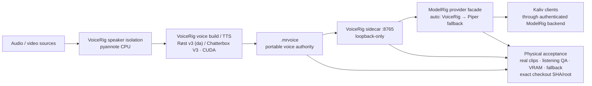

# VoiceRig

_Documentation baseline: 2026-11-11 · V1 accepteret på RC25 (`release/voicerig-v1-physical-rc25`, `587e6cc`); V1-kandidaten fra 2026-10-01 er bevaret som branch `candidate/v1-20261001` (`9f3e594`); `main` er post-V1-udvikling._

VoiceRig er et lokalt Windows-system til at lave portable ModelRig-stemmeprofiler ud fra almindelige lyd- og videoklip.

**Produktflowet er bevidst enkelt:** vælg 1–10 klip → giv stemmen et navn → VoiceRig finder den rigtige speaker, bygger stemmen og installerer en `.mrvoice` direkte i ModelRig.

## System position



VoiceRig owns voice-package creation and voice/TTS runtime authority. ModelRig
owns user-facing orchestration and authenticated client access. A software-green
VoiceRig checkout is not a release verdict until the physical acceptance chain
has passed on the exact candidate revision.

## VoiceRig V1

V1 indeholder hele den daglige produktvej:

- lyd/video-ingest gennem FFmpeg,
- lokal `pyannote/speaker-diarization-community-1` til flere talere,
- cross-file speaker matching og automatisk valg ved tydelig dominans,
- afspilleligt speaker-valg ved reel tvivl,
- kvalitetssortering og stitching af rene taleturns,
- Røst v3 (dansk-finetunet Chatterbox Multilingual-checkpoint) som standard for dansk; Chatterbox Multilingual V3 for øvrige sprog,
- portabel `.mrvoice` med checksums, reference, conditioning og preview,
- automatisk lokal ModelRig-installation,
- stemmebibliotek med preview, aktiv/default, import, eksport og sikker sletning,
- **Test stemme** med vilkårlig tekst direkte i VoiceRig uden at ændre ModelRig-default,
- persistente voice-build jobs med progress, cancel og resume efter browser-refresh,
- lokal TTS-sidecar til ModelRig,
- Piper fallback i ModelRig,
- secret-safe ModelRig-tokenkonfiguration direkte fra System-fanen,
- diagnostics og support-ZIP uden kildeaudio, profiler eller tokens,
- stabil per-user storage, retention og cleanup,
- Windows install/update/rollback/uninstall,
- loopback-only sikkerhedsgrænse som produktdefault.

VoiceRig er local-first. Kildeklip sendes ikke til cloud af VoiceRig.

## Hardwaremål

VoiceRig V1 målretter Windows 10/11 med én NVIDIA-GPU i **12 GB-klassen**, herunder RTX 3060 12 GB.

Runtime er bevidst delt:

- `.venv`: VoiceRig + verificeret Chatterbox Multilingual V3 source-revision + Torch/Torchaudio 2.6.0 CUDA 12.6. Røst v3 kører i samme runtime (pinnet Hugging Face-revision i `voicerig/model_contract.py`).
- `.venv-diarization`: pyannote.audio 4.0.7 + Torch 2.8.0 + Torchaudio 2.8.0 + TorchCodec 0.7.0, CPU-only.

Speaker-analyse bruger dermed ikke GPU-VRAM, som reserveres til Chatterbox/Røst. VoiceRig normaliserer input til mono PCM16 WAV og sender waveformen in-memory til pyannote.

## Installation på Windows

Den normale produktinstallation er:

```powershell
.\install-windows.ps1
```

Installeren:

1. finder eller installerer Git, FFmpeg og Python 3.11 via winget,
2. opretter de isolerede VoiceRig- og diarization-runtimes,
3. installerer den verificerede CUDA/Chatterbox- og CPU/pyannote-stack,
4. henter og verificerer Chatterbox V3 og pyannote community-1 (Røst hentes først ved første danske build, se nedenfor),
5. håndterer første Hugging Face-adgang interaktivt hvis pyannote kræver den,
6. skriver model-readiness i den stabile per-user datamappe,
7. sætter per-user autostart,
8. starter og verificerer den lokale service mod **samme checkout-root og startup Git HEAD**,
9. åbner VoiceRig i browseren.

`setup-windows.ps1` er den lavere niveau setup/acceptance-vej. Almindelige installationer bør bruge `install-windows.ps1`.

### Første pyannote-download

`community-1` er en gated Hugging Face-model. Hvis warmup mangler adgang, åbner installeren model-siden og beder om et read-token **med skjult input**. Tokenet gemmes kun i repoets lokale `.env`; det sendes ikke til VoiceRigs supportpakke.

Hvis modellen allerede er tilgængelig/cachet, spørger installeren ikke om et token.

`PYANNOTE_METRICS_ENABLED=0` er produktdefault.

`setup-windows.ps1` opretter `.env` ud fra `.env.example`, hvis `.env` ikke findes. `.env.example` beskriver alle VoiceRig-variabler.

### Første danske build (Røst)

Model-warmup og readiness-markøren dækker kun Chatterbox V3 og pyannote. Røst v3-checkpointet (`CoRal-project/roest-v3-chatterbox-500m`, pinnet revision) hentes fra Hugging Face med `snapshot_download` første gang Røst indlæses — normalt ved første danske voice-build. Det første danske build kræver derfor netværk og tager længere tid; readiness kan være grøn, før Røst er hentet.

## Data og privatliv

Uden en eksplicit `VOICERIG_DATA_DIR` bruger VoiceRig en stabil per-user placering:

```text
%LOCALAPPDATA%\VoiceRig
```

Ældre installationer, hvor `.env` indeholder `VOICERIG_DATA_DIR=voicerig-data`, migreres automatisk til den stabile placering. En reel brugerdefineret path respekteres stadig.

Færdig jobhistorik er bounded, og pauserede speaker-jobs udløber, så private kildeklip ikke ligger uendeligt. Support-ZIP indeholder kun systemmetadata og redigerede logs — aldrig kildeklip, WAV-filer, `.mrvoice`-profiler eller tokens.

## Brug

Start/åbn VoiceRig med:

```powershell
.\start-windows.ps1
```

UI kører på `http://127.0.0.1:8765` og er loopback-only som standard. Produktstart accepterer ikke en service fra en anden checkout eller en stale proces, der blev startet før checkoutets Git HEAD ændrede sig.

**Opret stemme** er først aktiv, når hardware- og model-readiness er grøn. Ved flerspeaker-tvivl vises korte afspillelige prøver; brugerens valg bindes til et konkret taleturn, hvorefter buildet fortsætter automatisk.

I **Mine stemmer** kan profiler previewes, importeres, eksporteres, aktiveres i ModelRig, slettes og testes med egen tekst.

I **System** vises runtime/GPU/model/ModelRig-status, repair-flow, secret-safe ModelRig device-token-konfiguration samt download af privacy-redigeret supportpakke. Tokenværdien returneres aldrig fra VoiceRigs config-API; UI'et kan kun se, om et token er konfigureret.

## `.mrvoice`

`.mrvoice` er en data-only ZIP-container. En profil indeholder mindst:

- `manifest.json`
- `checksums.json`
- `reference.wav`
- `conditioning.pt`
- `preview.wav`

og kan indeholde dokumenterede backup-references.

Profiler registrerer den eksakte engine/model/revision (Røst eller Chatterbox V3). Hvis en senere VoiceRig-version bruger en anden revision, genbruges gammel serialized conditioning ikke blindt; den regenereres fra `reference.wav`.

Se [`docs/MRVOICE_SPEC.md`](docs/MRVOICE_SPEC.md) og [`docs/LANGUAGE_LOCALE_ACCENT.md`](docs/LANGUAGE_LOCALE_ACCENT.md).

## ModelRig

På samme maskine installeres `.mrvoice` atomisk i ModelRigs voice-mappe og kan markeres default. ModelRig kan bruge VoiceRigs sidecar på `127.0.0.1:8765` uden at loade en ekstra Chatterbox-model i sin worker-VRAM.

ModelRig beholder Piper som fallback, når VoiceRig ikke er tilgængelig i `auto`-provider-flowet.

Hvis ModelRigs backend kræver et parret device-token, kan det gemmes fra **System → ModelRig authentication**. Tokenet skrives lokalt til VoiceRigs `.env`, slår igennem i den kørende proces med det samme og sendes aldrig tilbage til browseren efter gem.

Sidecar-kontrakten (`/api/tts/status`, `/api/tts/synthesize`), hvem der vælger package, og ModelRig-sidens variabler (`TTS_PROVIDER`, `VOICERIG_TTS_URL`, `VOICERIG_TTS_TIMEOUT_SECONDS`, `MODELRIG_VOICES_DIR`) står i [`docs/MODELRIG_INTEGRATION.md`](docs/MODELRIG_INTEGRATION.md).

## Update og recovery

Opdatér en eksisterende checkout med:

```powershell
.\update-windows.ps1
```

Updateren installerer og verificerer den nye revision og ruller tilbage til den tidligere fungerende HEAD, hvis den nye service ikke kan installeres/starte korrekt. En opdatering godkendes kun, når den aktive service rapporterer den nye clean startup-identitet fra den samme checkout-root.

Afinstallation:

```powershell
.\uninstall-windows.ps1
```

Afinstalleren stopper kun VoiceRig-processer og autostart, der kan knyttes til **denne checkout**. En anden VoiceRig-checkout på samme maskine røres ikke.

Brugerdata og profiler bevares som udgangspunkt. Lokale `HF_TOKEN`/`MODELRIG_TOKEN`-værdier ryddes fra VoiceRigs `.env` som sikker standard. Hvis de bevidst skal bevares til en senere geninstallation:

```powershell
.\uninstall-windows.ps1 -KeepSecrets
```

Slet også brugerdata og profiler eksplicit med:

```powershell
.\uninstall-windows.ps1 -RemoveData
```

`-RemoveData` spørger VoiceRigs egen config om den autoritative datamappe **før** runtime fjernes, så også en brugerdefineret `VOICERIG_DATA_DIR` i `.env` rammes korrekt.

## Fysisk rig-validering

Preflight:

```powershell
.\validate-rig.ps1
```

Fuld produkt-E2E med rigtige klip:

```powershell
.\validate-rig.ps1 `
  -Source "C:\klip\stemme1.mp4","C:\klip\stemme2.m4a" `
  -Name "VoiceRig Acceptance"
```

Den fulde validator bruger den kørende VoiceRig-service til både build og syntese og binder acceptance-rapporten til et clean checkout samt service-processens **startup revision og checkout-root**. En gammel proces kan derfor ikke bestå ved blot at Git HEAD ændres under den.

Med ModelRig som hård gate:

```powershell
$env:MODELRIG_TOKEN = "<parret device-token>"
.\validate-rig.ps1 `
  -Source "C:\klip\stemme1.mp4","C:\klip\stemme2.m4a" `
  -Name "VoiceRig Acceptance" `
  -RequireModelRig `
  -RequirePiperFallback
```

Efter manuel lyttekontrol afsluttes releasebeviset med:

```powershell
.\complete-acceptance.ps1 `
  -QualityPass `
  -QualityNote "Tydelig dansk, genkendelig stemme, ingen alvorlige artefakter"
```

Se [`docs/RIG_ACCEPTANCE.md`](docs/RIG_ACCEPTANCE.md) og [`docs/RELEASE_GATE.md`](docs/RELEASE_GATE.md). Flytning af brugerdata mellem maskiner er beskrevet i [`docs/RIG_MIGRATION.md`](docs/RIG_MIGRATION.md).

## Scripts og flag

Alle scripts ligger i repo-roden og køres fra en PowerShell i checkoutet.

| Script | Formål | Parametre |
| --- | --- | --- |
| `install-windows.ps1` | Normal produktinstallation (afhængigheder, runtimes, warmup, autostart, start) | `-SkipModelWarmup`, `-NoBrowser` |
| `setup-windows.ps1` | Lavere niveau setup/acceptance-vej; opretter `.env` fra `.env.example` | `-SkipModelWarmup` |
| `start-windows.ps1` | Start/åbn den lokale service | `-NoBrowser` |
| `update-windows.ps1` | Opdatér checkout med rollback ved fejl | `-SkipModelWarmup` |
| `uninstall-windows.ps1` | Afinstallér denne checkouts service/autostart/runtime | `-RemoveData`, `-KeepSecrets` |
| `install-autostart.ps1` | Per-user autostart via Startup-mappen | — |
| `uninstall-autostart.ps1` | Fjern autostart | — |
| `validate-rig.ps1` | Preflight og fuld fysisk E2E | `-Source <filer>`, `-Name`, `-RequireModelRig`, `-RequirePiperFallback`, `-VoiceRigUrl`, `-ModelRigUrl`, `-ModelRigWorkerUrl`, `-ModelRigToken` (default `$env:MODELRIG_TOKEN`) |
| `test-piper-fallback.ps1` | Piper fallback + VoiceRig-restore; kaldes af `validate-rig.ps1 -RequirePiperFallback` | `-VoiceRigUrl`, `-ModelRigUrl`, `-ModelRigWorkerUrl`, `-ModelRigToken`, `-Report` |
| `complete-acceptance.ps1` | Skriv `release-acceptance.json` efter lyttekontrol | `-QualityPass`, `-QualityNote`, `-ValidationReport`, `-FallbackReport`, `-Output` |
| `record-engine-decision.ps1` | Registrér dansk motorbeslutning (se `docs/RELEASE_GATE.md`) | `-Winner {chatterbox\|rost\|omnivoice\|none}`, `-ChatterboxScore`, `-RostScore`, `-OmniVoiceScore`, `-DecisionNote`, `-TestText` (påkrævede), `-ChatterboxNote`, `-RostNote`, `-OmniVoiceNote`, `-Output` |
| `migrate-state-windows.ps1` | Eksport/import af brugerdata (se `docs/RIG_MIGRATION.md`) | `-Action {Export\|Import\|Verify}` (påkrævet), `-Archive`, `-OutDir`, `-ForceRestore`, `-NoRestart` |
| `configure-repository-authority.ps1` | Vis/anvend branch protection og required checks på `main` (kræver `gh` med admin-ret) | `-Apply` |
| `verify-repository-authority.ps1` | Verificér at branch protection på `main` matcher de forventede checks (kræver `gh`) | — |

Default-URL'er i validatorerne: VoiceRig `http://127.0.0.1:8765`, ModelRig backend `http://127.0.0.1:8080`, ModelRig worker `http://127.0.0.1:8099`.

## Lokal udvikling og test

Udviklings- og CI-vejen bruger Python 3.11 og kræver hverken GPU eller modeller:

```bash
python -m venv .venv
. .venv/bin/activate
python -m pip install -e ".[test]"
python -m pytest -q
python -m compileall -q voicerig
node --check voicerig/ui/app.js
```

Valgfrie extras i `pyproject.toml`:

- `[test]` — pytest.
- `[voice]` — Chatterbox Multilingual V3 fra den pinnede Git source-revision (kræves til build/TTS; også til Røst).
- `[diarization]` — `pyannote.audio==4.0.7`. Skal installeres i et **separat** miljø (`.venv-diarization`), fordi pyannote og Chatterbox kræver forskellige Torch-versioner.

`voicerig` (console-script, `voicerig.app.main:run`) starter servicen på `127.0.0.1:8765`. UI og API starter uden `[voice]`; voice-build og TTS kræver Chatterbox.

## Build og CI

VoiceRig-versionen har én kilde i `voicerig/__init__.py`. CI-gaterne omfatter:

1. kører unit/regression-tests,
2. compile-checker Python,
3. syntax-checker browser-JavaScript med Node,
4. bygger wheel og sdist,
5. installerer wheel i en frisk runtime uden for source-træet,
6. starter den installerede VoiceRig-service på Linux og tester UI-assets/config/diagnostics over rigtig localhost HTTP,
7. bygger og installerer samme produktvej på Windows og tester service/UI/assets/diagnostics over localhost HTTP,
8. parser alle PowerShell-scripts med både moderne PowerShell og Windows PowerShell 5.1,
9. kører installerens faktiske retry/stop-logik mod en editable Windows-service og beviser filfrigivelse,
10. kører en separat Windows A/B-checkout lifecycle-smoke, der beviser stale-process-afvisning, foreign-start-afvisning, foreign-uninstall isolation og sikker uninstall af den ejende checkout.

### Workflows

| Workflow | Jobs | Trigger | Indhold |
| --- | --- | --- | --- |
| `test.yml` | `unit`, `windows-service-smoke` | push til `main`, pull request, manuel | pytest, compileall, `node --check`, wheel + sdist, installeret-wheel Linux HTTP-smoke, PowerShell-parse (pwsh + 5.1), installer retry/file-release, Windows service HTTP-smoke |
| `windows-lifecycle.yml` | `ownership-smoke` | push til `main`, pull request, manuel | warmup-stderr-smoke, A/B-checkout stale/foreign/uninstall-isolation |
| `danish-engine-contract.yml` | `packaged-contract` | push til `main`, pull request, manuel | JS-syntaks, wheel, at engine- og locale-assets er pakket |
| `codeql.yml` | `Analyze (python)`, `Analyze (javascript-typescript)` | push og pull request mod `main`, ugentlig (mandag) | CodeQL |
| `exact-head-qualification.yml` | `linux-package-and-tests`, `windows-runtime` | push til `main`, manuel med `head_sha` | assert af eksakt checkout-SHA, pytest, compileall, JS, build; Windows PowerShell-syntaks + package-smoke |

Push-kørsler sker kun på `main`; en PR-branch får én `pull_request`-kørsel pr. commit, og i `test`, `windows-lifecycle` og `danish-engine-contract` afbryder en nyere PR-kørsel den forrige. Dependabot (`.github/dependabot.yml`) åbner ugentlige, grupperede PR'er for GitHub Actions og pip.

### Required checks på `main`

`unit`, `packaged-contract`, `ownership-smoke`, `windows-service-smoke`, `Analyze (python)` og `Analyze (javascript-typescript)`. Listen er defineret i `configure-repository-authority.ps1` (anvendes med `-Apply`) og kontrolleres med `verify-repository-authority.ps1`.

Accepterede release-pins og deres evidence-issues står i [`docs/RELEASE_CANDIDATE_POLICY.md`](docs/RELEASE_CANDIDATE_POLICY.md) (V1: RC25, issue #18/#19), ikke som et hårdkodet SHA her.

## Release-status

Release status is **evidence-driven**, not tied to a permanent PR number.
The candidate is releasable only when the exact clean VoiceRig revision has:

- green repository CI;
- successful Windows product installation/model warmup;
- physical build + synthesis from real clips;
- manual Danish voice-likeness/quality PASS;
- measured server-process VRAM within the target 12 GB class;
- ModelRig provider integration PASS;
- Piper fallback and restore PASS;
- a final content-bound `release-acceptance.json` verdict.

Any source change after physical acceptance makes that evidence stale.

V1 passed this chain on RC25; see [`docs/RELEASE_CANDIDATE_POLICY.md`](docs/RELEASE_CANDIDATE_POLICY.md).

## Kendte begrænsninger

Mulighederne for hvert punkt og de tilhørende kodefund står i [issue #38](https://github.com/Ternedal/VoiceRig/issues/38).

- **Remote/split-host ModelRig er ikke implementeret.** Uden loopback-`MODELRIG_BASE_URL` (eller med `MODELRIG_LOCAL_INSTALL=0`) poster VoiceRig til `/api/v1/voices/import`, som ModelRig ikke har. Installationen i ModelRig fejler da, mens profilen bliver i VoiceRigs bibliotek. Se [`docs/MODELRIG_INTEGRATION.md`](docs/MODELRIG_INTEGRATION.md).
- **Port 8765 er fast.** `voicerig`-entrypointet (brugt af `start-windows.ps1` og autostart) binder altid `127.0.0.1:8765`; port og bind-adresse kan ikke konfigureres via `.env`.
- **Røst hentes ved første danske build**, ikke under warmup; readiness kan være grøn, før den danske standardmotor er hentet.
- **`VOICERIG_ALLOW_LAN=1` løfter kun request-guarden.** Bind forbliver `127.0.0.1`; LAN-adgang kræver desuden manuel start af uvicorn med en anden `--host`. HTTP-fladen er uautentificeret.
- **`.mrvoice`-import validerer locale kun syntaktisk** (se implementeringsstatus i [`docs/MRVOICE_SPEC.md`](docs/MRVOICE_SPEC.md#sikkerhedsgrænser)).

## Dokumentation

| Dokument | Indhold | Status |
| --- | --- | --- |
| [`docs/ARCHITECTURE.md`](docs/ARCHITECTURE.md) | Runtimes, pipeline, GPU-invariant, ModelRig-grænse | Levende |
| [`docs/MODELRIG_INTEGRATION.md`](docs/MODELRIG_INTEGRATION.md) | Same-host install, sidecar-kontrakt, ModelRig-variabler | Levende |
| [`docs/MRVOICE_SPEC.md`](docs/MRVOICE_SPEC.md) | `.mrvoice` v1-formatet | Levende (normativ) |
| [`docs/LANGUAGE_LOCALE_ACCENT.md`](docs/LANGUAGE_LOCALE_ACCENT.md) | Sprog, locale, accent; dansk standardmotor | Levende (normativ) |
| [`docs/RIG_ACCEPTANCE.md`](docs/RIG_ACCEPTANCE.md) | Fysisk acceptance-runbook | Levende |
| [`docs/RELEASE_GATE.md`](docs/RELEASE_GATE.md) | Final release gate | Levende |
| [`docs/RIG_MIGRATION.md`](docs/RIG_MIGRATION.md) | Flytning af brugerdata mellem maskiner | Levende |
| [`docs/RELEASE_CANDIDATE_POLICY.md`](docs/RELEASE_CANDIDATE_POLICY.md) | RC-refs, accepterede V1-pins, RC-historik | Policy |
| [`KRAVSPEC.md`](KRAVSPEC.md) | V1-krav og sporbarhed | Kravspecifikation (V1) |
| [`docs/ENGINE_PORTABILITY.md`](docs/ENGINE_PORTABILITY.md) | Engine-katalog, kompatibilitet, RC19-beslutningsgrundlag | Historisk kontekst |
| [`.env.example`](.env.example) | Alle VoiceRig-miljøvariabler | Levende |

VoiceRigs plads i det samlede system er defineret i
[ModelRig: docs/KALIV_SYSTEM_DEFINITION.md](https://github.com/Ternedal/ModelRig/blob/main/docs/KALIV_SYSTEM_DEFINITION.md).
De øvrige repositories er listet i
[Kaliv-repoets README](https://github.com/Ternedal/Kaliv#relaterede-repositories).
