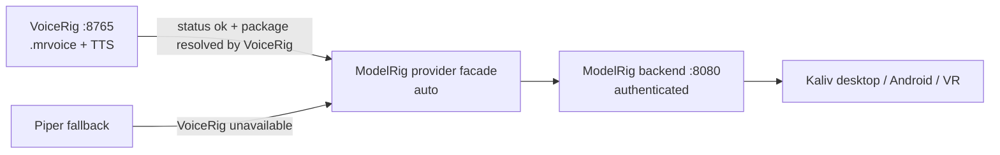

# ModelRig integration contract

_Last reviewed against `main` on 2026-11-11._

## Same-host installation (default)

VoiceRig and ModelRig normally run on the same Windows machine. VoiceRig therefore
installs a completed `.mrvoice` directly into:

```text
~/.kaliv/voices/
```

and atomically writes `default.txt` with the installed package filename. ModelRig
does not have to be running while the voice is created.

The filesystem handoff is used only when `MODELRIG_BASE_URL` points to a loopback
host (`127.0.0.1`, `localhost`, `::1`) **and** `MODELRIG_LOCAL_INSTALL` is not
`0` (`voicerig/modelrig/client.py`). Override the directory with
`MODELRIG_VOICES_DIR`; VoiceRig and the ModelRig worker must use the same value
(both default to `~/.kaliv/voices`).

### Who selects the package

ModelRig does not read `default.txt` and does not parse the manifest. It only
checks whether at least one `*.mrvoice` exists in `MODELRIG_VOICES_DIR`. The
VoiceRig sidecar resolves which package to speak with:

1. `voice_package` sent by ModelRig in the synthesis request (a person profile
   bound to a voice), otherwise
2. the filename in `default.txt`, otherwise
3. the only `.mrvoice` in the directory (several profiles without a default is an
   error).

If ModelRig asks for a `voice_package` that VoiceRig rejects with a 4xx (VoiceRig
answers 404 for an unknown or malformed package name), ModelRig retries once
without `voice_package`, i.e. with VoiceRig's default.

## Remote/API mode — not implemented

When the filesystem handoff does not apply (non-loopback `MODELRIG_BASE_URL` or
`MODELRIG_LOCAL_INSTALL=0`), VoiceRig posts the package to:

```http
POST <MODELRIG_BASE_URL>/api/v1/voices/import
Content-Type: multipart/form-data
voice=<file.mrvoice>
```

ModelRig has **no such route**: neither the Go backend nor the worker implements
`/api/v1/voices/import`. In that configuration the ModelRig install step fails
(`ModelRig afviste stemmen: HTTP 404` or `ModelRig kunne ikke kontaktes`). A voice
build still completes and the profile stays in VoiceRig's library; the build
result reports `installed_in_modelrig: false` with the error in
`modelrig_detail`. Split-host deployment is therefore not supported today.

## Sidecar contract

ModelRig's worker (`worker/app/voice_tts.py` in ModelRig) calls two VoiceRig
endpoints on the loopback sidecar (`voicerig/app/tts_api.py`):

### `GET /api/tts/status`

Always `200` with a JSON object. When the resolved package and the Chatterbox
runtime are usable:

```json
{
  "ok": true,
  "detail": null,
  "voice": "<manifest name>",
  "voice_id": "<manifest id>",
  "package": "<file>.mrvoice",
  "language": "da-DK",
  "language_id": "da",
  "accent": null,
  "engine": "chatterbox-multilingual",
  "model": "roest-v3-chatterbox-500m",
  "revision": "<40-hex>",
  "device": "cuda"
}
```

Otherwise `{"ok": false, "detail": "<reason>", "voice": …, "package": …}` (no
package installed, Chatterbox not installed, no usable device). ModelRig uses
VoiceRig only when `ok` is `true`.

### `POST /api/tts/synthesize`

Request body (JSON):

```json
{ "text": "Hej fra Kaliv.", "voice_package": "optional-file.mrvoice" }
```

- `text`: 1–4000 characters.
- `voice_package`: optional bare `.mrvoice` filename in the voices directory.

Response `200`, `Content-Type: audio/wav` (PCM16 WAV), with headers:

| Header | Value |
| --- | --- |
| `X-VoiceRig-Voice` | profile name |
| `X-VoiceRig-Voice-ID` | manifest id |
| `X-VoiceRig-Package` | package filename used |
| `X-VoiceRig-Engine`, `X-VoiceRig-Model`, `X-VoiceRig-Revision` | engine identity |
| `X-VoiceRig-Sample-Rate`, `X-VoiceRig-Duration` | audio metadata |
| `X-VoiceRig-Device` | e.g. `cuda` |
| `X-VoiceRig-Peak-Allocated-GB`, `X-VoiceRig-Peak-Reserved-GB`, `X-VoiceRig-Allocated-GB`, `X-VoiceRig-Reserved-GB` | only when CUDA is available |

Header values are percent-encoded UTF-8 (`quote(value, safe="._-")`); ModelRig
decodes them before comparing package names.

Errors: `404` when the package cannot be resolved (unknown/invalid name, none
installed, several without a default), `422` for a request that fails validation,
`503` when synthesis fails at runtime.

## ModelRig-side configuration

Read by the ModelRig worker (`worker/app/voice_tts.py`):

| Variable | Default | Meaning |
| --- | --- | --- |
| `TTS_PROVIDER` | `auto` | `auto`: VoiceRig when a `.mrvoice` exists and `/api/tts/status` is `ok`, otherwise Piper; a VoiceRig synthesis error in `auto` falls back to Piper. `voicerig`: VoiceRig only, no fallback. `piper`: Piper only. Unknown values mean `auto`. |
| `VOICERIG_TTS_URL` | `http://127.0.0.1:8765` | VoiceRig sidecar base URL. |
| `VOICERIG_TTS_TIMEOUT_SECONDS` | `180` | Synthesis request timeout (minimum 1). The status probe uses 1.5 s. |
| `MODELRIG_VOICES_DIR` | `~/.kaliv/voices` | Must match VoiceRig's `MODELRIG_VOICES_DIR`. |

`TTS_PROVIDER`, `VOICERIG_TTS_URL` and `VOICERIG_TTS_TIMEOUT_SECONDS` are read
literally and, if unset, as `KALIV_<name>` and then `ALVA_<name>`;
`MODELRIG_VOICES_DIR` is read literally only.


## Runtime boundary



Kaliv clients do not call VoiceRig directly as their product authority. The
release acceptance checks ModelRig through its authenticated backend and requires
the active provider/package to match the VoiceRig candidate being accepted.
